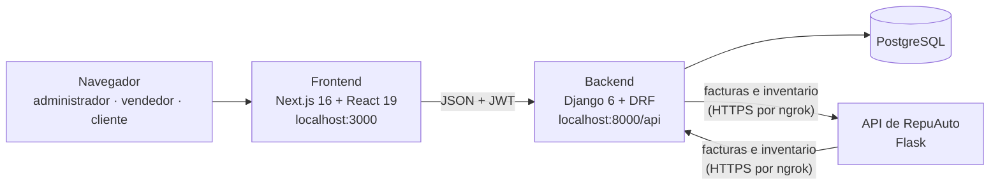
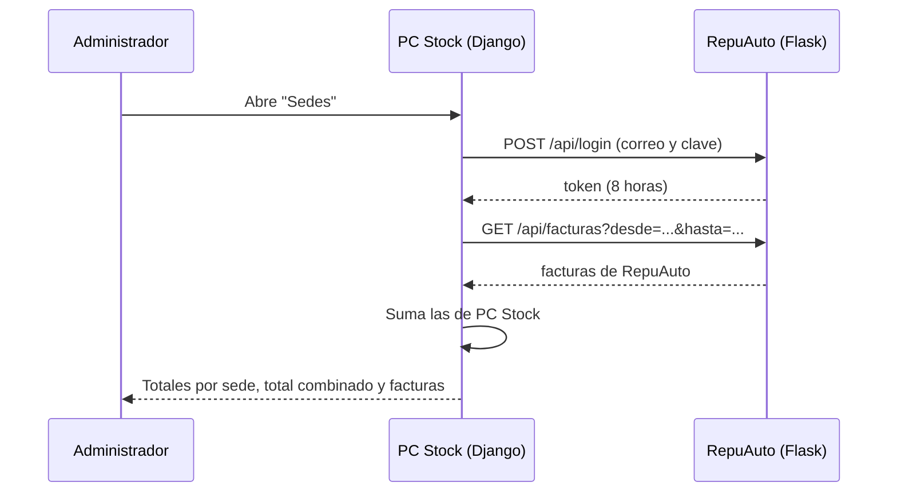
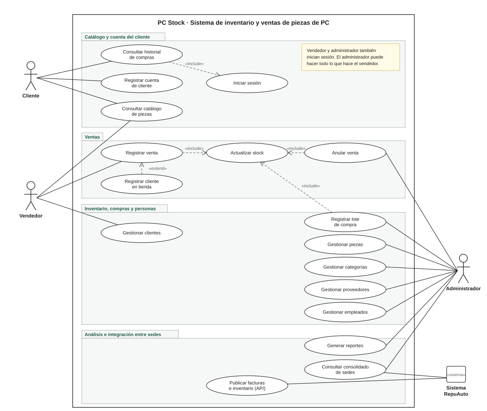
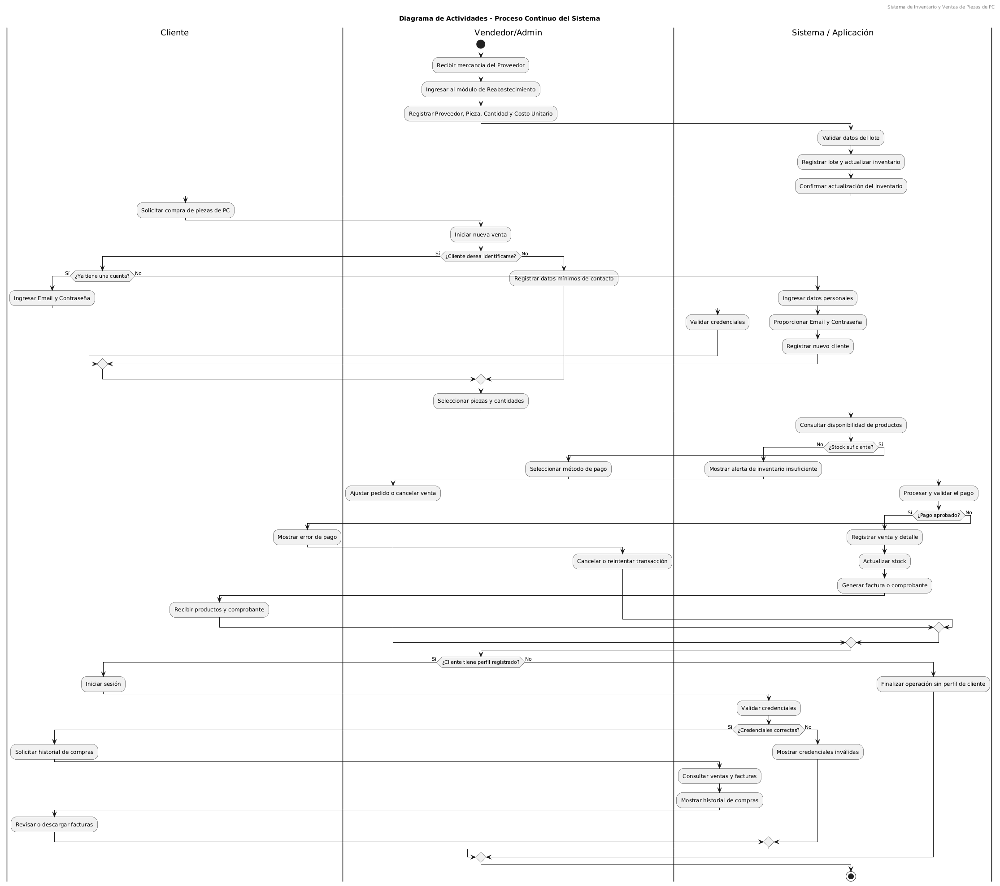
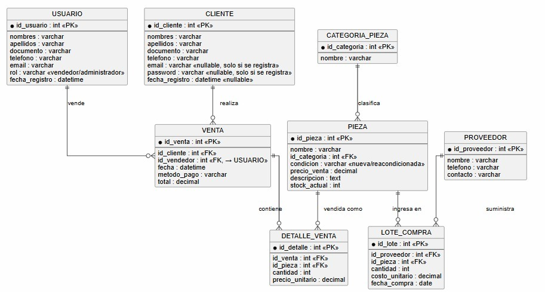
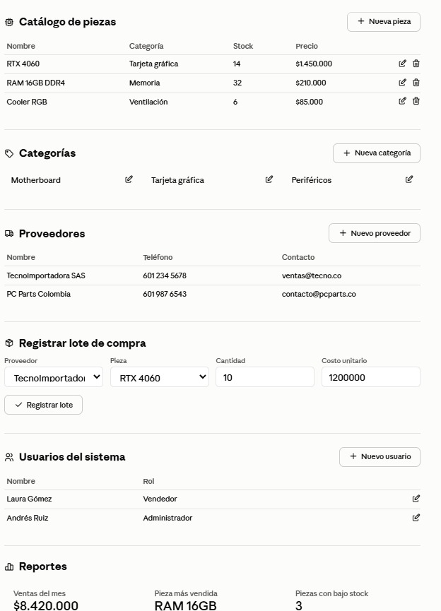
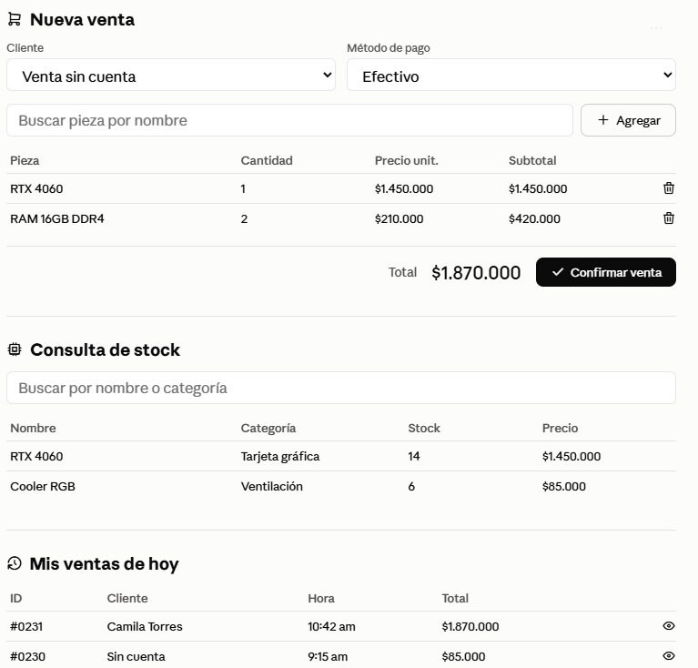
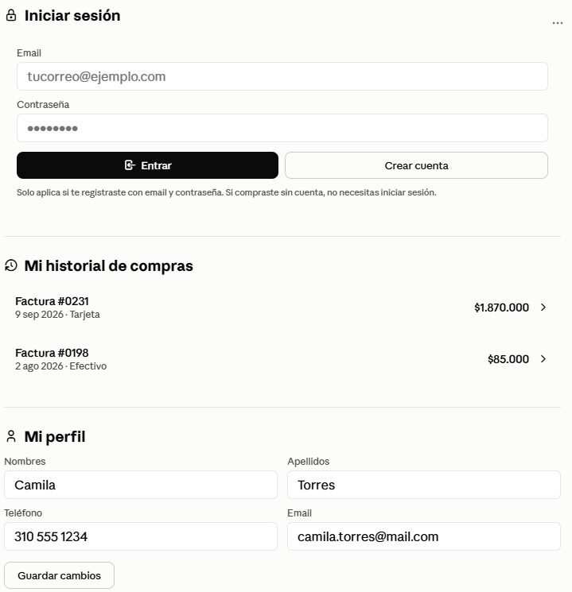

# PC Stock

**Sistema de inventario y ventas de piezas de computador, nuevas y reacondicionadas.**

Proyecto de Ingeniería de Software II · Universidad Industrial de Santander · 2026 · Grupo UD1

PC Stock reemplaza el control manual de una tienda de piezas de computador: lleva el inventario por
lotes de compra, registra ventas sin errores de stock, da a cada rol solo lo que necesita y se integra
con **RepuAuto**, la serviteca de repuestos de carro de otro grupo del curso, para ver las dos sedes
juntas.

| Backend | Frontend | Base de datos | Pruebas |
|---|---|---|---|
| Django 6 · Django REST Framework · JWT | Next.js 16 · React 19 · TypeScript | PostgreSQL | 95 pruebas automáticas |

---

## Contenido

1. [Qué hace](#1-qué-hace)
2. [Arquitectura](#2-arquitectura)
3. [Integración con RepuAuto](#3-integración-con-repuauto)
4. [Análisis y diseño](#4-análisis-y-diseño)
5. [Requerimientos](#5-requerimientos)
6. [Cómo correrlo](#6-cómo-correrlo)
7. [Estructura del repositorio](#7-estructura-del-repositorio)
8. [Documentación](#8-documentación)
9. [Equipo](#9-equipo)

---

## 1. Qué hace

Cada usuario ve un menú distinto según su rol. El rol lo decide el servidor, nunca el navegador.

| Rol | Puede |
|---|---|
| **Administrador** | Todo lo del vendedor, más: crear y editar piezas, registrar entradas de mercancía (lotes), anular ventas, gestionar empleados, ver **Reportes** y el consolidado de **Sedes** |
| **Vendedor** | Registrar ventas, consultar inventario, clientes y proveedores |
| **Cliente** | Ver el catálogo con precios y disponibilidad, y el historial de **Mis compras** |

Reglas que el sistema garantiza:

- **El stock no se edita a mano.** Solo sube con los lotes de compra y baja con las ventas, así siempre
  cuadra con el historial.
- **Las ventas son atómicas.** Si una pieza no tiene stock, no se guarda nada; el precio sale de la pieza
  y el total lo calcula el servidor.
- **Las ventas no se borran.** Solo el administrador las anula, y el stock se devuelve.
- **Nada se borra si tiene historial** (una pieza con ventas, un proveedor con lotes): la API responde
  `409` en lugar de fallar.
- **Valores en pesos colombianos (COP).**

---

## 2. Arquitectura



- **El navegador solo habla con nuestro backend.** Las llamadas a la otra sede las hace el servidor.
- **Autenticación con JWT.** El token de acceso se renueva solo; el rol se resuelve por el vínculo entre
  la cuenta y el empleado, nunca por el correo (eso evitaba un escalamiento de privilegios).
- **Límite de intentos** en el inicio de sesión y en el registro.

---

## 3. Integración con RepuAuto

Las dos sedes publican sus datos con **el mismo formato JSON**, propuesto por RepuAuto y adoptado sin
cambios por PC Stock. Cada sede puede leer a la otra.



| Endpoint | Qué entrega | Estado |
|---|---|---|
| `POST /api/login` | Token para un administrador (`correo` y `clave`) | ✅ |
| `GET /api/facturas` | Ventas y compras del periodo, con IVA incluido y separado | ✅ |
| `GET /api/inventario` | Productos con stock, valor y estado (`en_stock`, `stock_bajo`, `agotado`) | ✅ |

- **Pantalla Sedes** (solo administrador), con dos pestañas:
  - **Facturas:** totales por sede y combinados, IVA por pagar y la lista de facturas con filtros y CSV.
  - **Inventario:** valor, productos y estado del stock de cada sede y de las dos juntas, y todos los
    productos con búsqueda, filtros por sede y estado, y CSV.
- **RepuAuto tiene su propio consolidado** que lee nuestra API con el mismo formato.
- **Si la otra sede no responde,** la pantalla sigue funcionando con PC Stock y dice por qué.
- **El token de integración solo sirve para leer:** no permite usar el resto de la API.
- **Despliegue:** cada equipo corre su aplicación y la publica con **ngrok** en un dominio fijo.
- **Sin depender de RepuAuto:** `backend/simular_repuauto.py` imita su API para probar y hacer demos.

El formato completo, las reglas y lo que hace cada equipo están en
**[CONTRATO-INTEGRACION.md](./CONTRATO-INTEGRACION.md)**.

---

## 4. Análisis y diseño

### Casos de uso

Lo que hace hoy cada actor. El administrador puede hacer todo lo del vendedor, y el sistema de la
otra sede (RepuAuto) consulta y alimenta el consolidado.

<p align="center"></p>

Frente al [diagrama del diseño inicial](docs/Diagramas/Casos_de_uso.png) se agregaron: gestionar piezas,
anular venta, gestionar clientes, generar reportes, el consolidado de sedes y la API para la otra sede.

### Diagrama de actividades

El proceso completo: llegada de mercancía, venta con o sin cuenta del cliente, validación de stock y
consulta del historial de compras.

<p align="center"></p>

### Base de datos

Modelo relacional en tercera forma normal, con todas las relaciones protegidas por llaves foráneas.

<p align="center"></p>

Cambios que hizo la implementación sobre el diseño original:

| Tabla | Cambio | Por qué |
|---|---|---|
| `VENTA` | `estado` (`activa` o `anulada`) | Las ventas no se borran: se anulan y el stock se devuelve |
| `CLIENTE` | La contraseña pasa a una cuenta de Django vinculada (`user`) | Las contraseñas las cifra y valida Django; el cliente sin cuenta sigue siendo posible |
| `USUARIO` | Vínculo `user` con la cuenta de Django | El rol se resuelve por ese vínculo y no por el correo |
| `PROVEEDOR` | `nit` | Va en las facturas de compra que se comparten con RepuAuto |
| `PIEZA` | `marca` | Va en el inventario que se comparte con RepuAuto |

### Vistas de usuario

Diseño inicial de las pantallas de cada rol.

<details>
<summary>Ver las tres vistas</summary>

| Administrador | Vendedor | Cliente |
|---|---|---|
|  |  |  |

</details>

---

## 5. Requerimientos

| ID | Requerimiento | Estado |
|---|---|---|
| RF01 | Registrar, consultar, actualizar y eliminar piezas | ✅ |
| RF02 | Clasificar piezas por categoría | ✅ |
| RF03 | Condición de cada pieza: nueva o reacondicionada | ✅ |
| RF04 | Proveedores asociados a los lotes de compra | ✅ |
| RF05 | Lotes de compra con pieza, proveedor, cantidad y costo | ✅ |
| RF06 | Stock actualizado automáticamente con lotes y ventas | ✅ |
| RF07 | Venta con cliente, vendedor, método de pago y varias piezas | ✅ |
| RF08 | Total de la venta calculado automáticamente | ✅ |
| RF09 | Compra sin registro previo, con datos mínimos de contacto | ✅ |
| RF10 | Cuenta de cliente opcional | ✅ |
| RF11 | El cliente consulta el historial de sus compras | ✅ |
| RF12 | Roles internos (vendedor y administrador) con permisos distintos | ✅ |
| RF13 | Catálogo con precio y disponibilidad | ✅ El cliente ve "disponible" o "agotado"; el stock exacto solo lo ven los empleados |
| RNF01 | Integridad referencial en toda la base | ✅ |
| RNF02 | Contraseñas cifradas, nunca en texto plano | ✅ |
| RNF03 | Consultas de stock e historial en tiempo aceptable | ✅ |
| RNF04 | Modelo escalable a nuevas categorías o atributos | ✅ |
| RNF05 | Disponible para el personal durante el horario de la tienda | ✅ |

Además de lo pedido: **Reportes** para el administrador (ingresos, utilidad estimada, ventas por día,
categoría, vendedor y método de pago, inventario valorizado; CSV e impresión) y la **integración con
RepuAuto**.

---

## 6. Cómo correrlo

Necesitas Python 3.12, [uv](https://docs.astral.sh/uv/), Node.js y PostgreSQL. La guía paso a paso,
desde la instalación hasta los datos de prueba, está en **[backend/SETUP.md](./backend/SETUP.md)**.

En resumen, con el `.env` ya configurado:

```powershell
# Backend (desde backend/)
uv run python manage.py migrate
uv run python manage.py runserver          # http://127.0.0.1:8000

# Frontend (desde frontend/)
npm install
npm run dev                                # http://localhost:3000
```

Cuentas de prueba (las crea `backend/poblar_datos.py`):

| Rol | Usuario | Contraseña |
|---|---|---|
| Administrador | `carlos.admin` | `Empleado.2026` |
| Vendedor | `laura.ventas` | `Empleado.2026` |
| Cliente | `andres.silva` | `Cliente.2026` |

Pruebas y verificación:

```powershell
uv run python manage.py test inventario    # desde backend/: 95 pruebas
npm run lint                               # desde frontend/: 0 problemas
npm run build
```

---

## 7. Estructura del repositorio

```
├── backend/
│   ├── Proyecto_UD1/            Configuración de Django (settings, urls)
│   ├── inventario/              App principal: modelos, API, permisos y pruebas
│   │   ├── integraciones/       API para la otra sede, cliente de RepuAuto y consolidado
│   │   └── reportes.py          Cálculo de los reportes del administrador
│   ├── poblar_datos.py          Datos de prueba
│   ├── simular_repuauto.py      Simulador de la API de RepuAuto
│   └── SETUP.md                 Guía de instalación del equipo
├── frontend/
│   ├── app/(app)/               Pantallas con sesión (ventas, inventario, reportes, sedes…)
│   ├── components/              Barra lateral y componentes comunes
│   └── lib/                     Cliente de la API, sesión y formatos
├── docs/
│   ├── Diagramas/               Casos de uso, actividades, base de datos y vistas
│   ├── UD_01_ISII_Format_260219.docx    Documento del proyecto
│   └── UD_01_ISII_Scrum_Trace.xlsx      Backlog, historias, épicas y burndown
└── CONTRATO-INTEGRACION.md      Acuerdo de integración con RepuAuto
```

---

## 8. Documentación

| Documento | Contenido |
|---|---|
| [backend/SETUP.md](./backend/SETUP.md) | Instalación, base de datos, datos de prueba, pruebas y frontend |
| [CONTRATO-INTEGRACION.md](./CONTRATO-INTEGRACION.md) | Formato de la API entre sedes, reglas, despliegue con ngrok y plan B |
| [docs/UD_01_ISII_Format_260219.docx](./docs/UD_01_ISII_Format_260219.docx) | Contexto, requerimientos, diseño y diagramas |
| [docs/UD_01_ISII_Scrum_Trace.xlsx](./docs/UD_01_ISII_Scrum_Trace.xlsx) | Scrum: épicas, historias de usuario, product backlog, sprint backlog y burndown |
| [docs/Instructivo-integracion-RepuAuto.docx](./docs/Instructivo-integracion-RepuAuto.docx) | Pasos que sigue RepuAuto para conectarse |
| [API de RepuAuto](https://github.com/Thiago3108/repuauto/blob/main/docs/API.md) | La documentación de la otra sede |

---

## 9. Equipo

| Integrante |
|---|
| David Esteban Suárez Lozano |
| Jonnier Fernando Corzo Bonilla |
| Miguel Ángel Ayala Fuentes |
| Miguel Ángel Parada Rodríguez |
| David Santiago Sáenz Ortiz |

**Profesor:** Urbano Eliécer Gómez Prada
